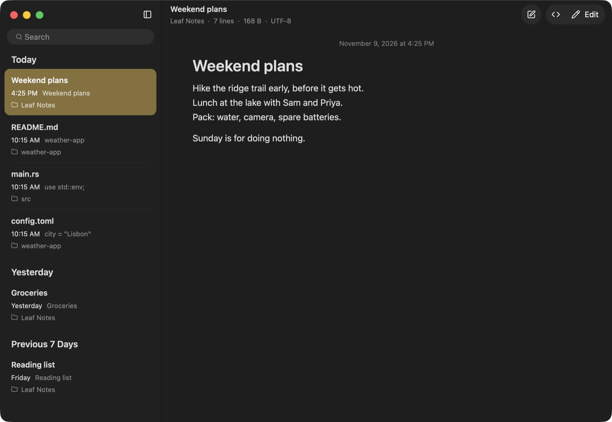
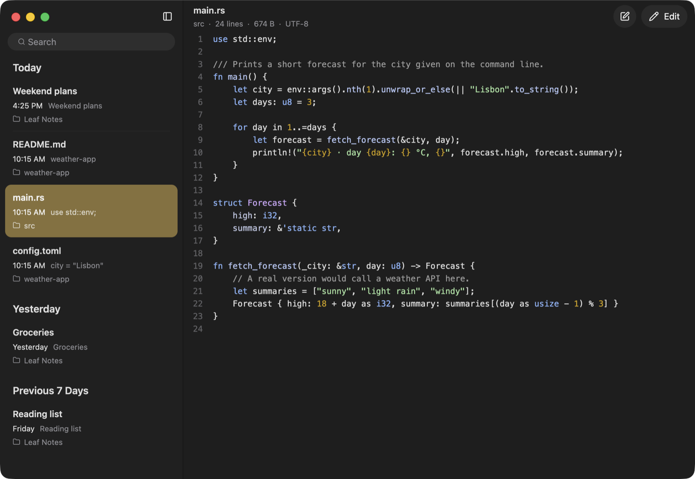
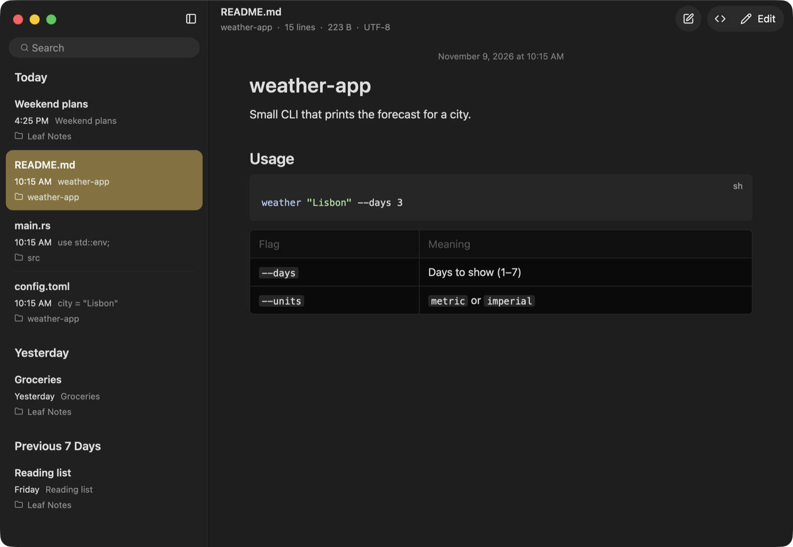
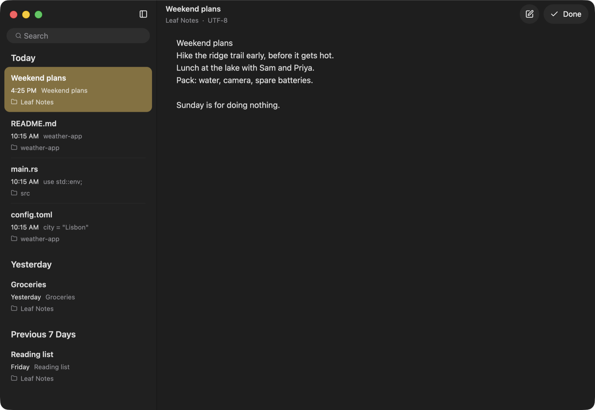

# Leaf

A small macOS text viewer and editor. Files open read-only, and editing is one keystroke away. Open files sit in a Notes-style sidebar and are only loaded when you look at them, so keeping hundreds open costs little.



Leaf exists because CotEditor slows down with many files open, and TextEdit is not a good viewer.

## Features

- **Viewer first.** Files open read-only. Press ⌘E or double-click to edit, and ⌘E again (or Done) to go back.
- **Lazy files.** A file is read when you open it, and only the 12 most recently viewed stay in memory. The sidebar reads just the first 2 KB of each file for its date and preview line.
- **Large files.** Files over 64 MB stay on disk and are read in 256 KB blocks as you scroll, while the line index is built in the background. A 200 MB log opens in about 0.2 s.
- **Log tailing.** When a file grows, only the new part is read. If you are at the bottom, the view follows new lines.
- **Filter.** ⇧⌘L shows only the lines that contain some text or match a `/regex/`. On a 200 MB, 2.5 million line log this takes a few seconds.
- **Highlighting** for about 200 languages, on a background thread, only for the lines you scroll to.
- **Pages.** Markdown renders as a page and `.txt` reads as wrapped prose. Minified JSON opens formatted, and CSV/TSV files open as a table. ⇧⌘V switches to the raw lines.
- **Notes.** ⌘N (or ⌘T) creates a Markdown note in `~/Documents/Leaf Notes`. Notes save as you type and take their name from the first line.
- **Encodings.** Shift_JIS, Windows-1252, UTF-16 and others are detected, and saving keeps the original encoding, BOM and line endings.
- **Search open files.** The sidebar search (⇧⌘F) matches file names and the text inside every open file, and shows the matching line. Opening a result jumps to it.
- **Compare.** ⇧⌘D compares the current file with the one you viewed before it, side by side. ⌥-click a file in the sidebar to compare with that one.
- **Safe saving.** Saves go to a temporary file that is renamed over the original, so a crash never leaves half a file. Leaf checks the file on disk before every save and will not overwrite changes made by another program without asking.
- **Recovery.** Unsaved edits are copied to `~/Library/Application Support/Leaf/Recovery` while you type. After a crash or a forced quit they come back the next time you open the file.
- **External changes.** Files changed by other programs reload when you come back to them. If you have unsaved edits, Leaf warns you instead.
- **Session.** Open files come back on the next launch, still unloaded until you click them.

| Code | Markdown | Editing a note |
|---|---|---|
|  |  |  |

## Memory use

Measured with `footprint` on an Apple Silicon Mac, release build, after the window settled:

| Situation | Memory |
|---|---|
| Empty window | 57 MB |
| One small text file | 61 MB |
| One small source file, highlighted | 76 MB |
| 300 files open, one shown | 75 MB |
| 7 MB source file (200,000 lines) | 83 MB |
| 200 MB log file | 62 MB |

Images in a rendered Markdown page add their decoded size (about 7 MB for each 1600×1100 screenshot). The app is about 15 MB on disk.

## Install

Download `Leaf-<version>-macos-arm64.zip` from [Releases](https://github.com/shhossain/leaf/releases), unzip it, and move `Leaf.app` to `/Applications`. Builds are for Apple Silicon.

The app is signed ad hoc, not notarized, so macOS blocks it on first launch. Remove the quarantine flag once:

```sh
xattr -dr com.apple.quarantine /Applications/Leaf.app
```

### Build from source

You need Rust (the version is pinned in `rust-toolchain.toml`; rustup installs it automatically) and the Xcode command line tools.

```sh
git clone https://github.com/shhossain/leaf
cd leaf
./scripts/install.sh   # builds Leaf.app and copies it to /Applications
```

The first build takes a few minutes and about 3 GB of disk space.

### Make Leaf the default app

In Finder, choose Get Info on a file, pick Leaf under "Open with", then click Change All.

Or set several types at once from the repo:

```sh
swift scripts/set-default.swift --show txt md json                              # current defaults
swift scripts/set-default.swift /Applications/Leaf.app txt md log json yaml toml
```

The script prints the previous app for each type, so you can switch back the same way.

## Keyboard

| Keys | Action |
|---|---|
| ⌘O | Open files |
| ⌘N, ⌘T | New note |
| ⌘E, double-click | Edit / Done |
| ⌘S | Save |
| ⌘W | Close file |
| ⇧⌘T | Reopen closed file |
| ⌃Tab, ⇧⌃Tab, ⌥⌘→, ⌥⌘← | Next / previous file |
| ⌘1 … ⌘8, ⌘9 | Go to that file in the sidebar, last file |
| ⌘F, ⌘G, ⇧⌘G | Find, next, previous match |
| ⌘L | Go to line |
| ⇧⌘L | Filter lines |
| ⇧⌘V | Page, table or formatted view / raw lines |
| ⇧⌘D, ⌥-click | Compare with the previous file / with that file |
| ⌘B, ⌥⌘S | Show or hide the sidebar |
| ⇧⌘F, ⌥⌘F | Search open files |
| Space, ⇧Space | Page down / up |
| ⌘↑, ⌘↓ | Top / bottom |
| Esc | Close the find or filter bar |

## How it works

Leaf is written in Rust on [GPUI](https://github.com/zed-industries/zed), the GPU-rendered UI framework from Zed, and [gpui-component](https://github.com/longbridge/gpui-component).

The viewer does not use a text editor widget. It keeps the file's bytes plus the start offset of every 64th line, and draws only the rows on screen. Syntax highlighting uses syntect on a worker thread per file: it saves the parser state every 128 lines, but only as far as you have scrolled, so a large file that you only glance at is never fully parsed. When you jump far ahead, lines are colored from an approximate state first and corrected once the exact pass catches up. The full editor (from gpui-component) is created only when you start editing a file, because it needs about twelve times the file's size in memory.

| File | Purpose |
|---|---|
| `src/workspace.rs` | Window, sidebar, open-file lifecycle, saving, session |
| `src/viewer.rs` | Read-only line view, find, filter, go to line, page, JSON and table views |
| `src/text_index.rs` | File bytes (in memory, or read from disk in blocks) and the sparse line index |
| `src/doc.rs` | Loading, appended-data detection, atomic writes |
| `src/highlight.rs` | Highlighting worker thread with checkpoints |
| `src/encoding.rs` | Encoding detection and round-trip on save |
| `src/file_list.rs` | Sidebar dates, preview lines, content search |
| `src/recovery.rs` | Copies of unsaved edits |
| `src/notes.rs` | Notes folder, auto-naming |
| `src/style.rs` | Colors |

Run the tests with `cargo test`.

## Limitations

- Apple Silicon only, and not notarized.
- Files over 16 MB are view-only. Files over 64 MB are assumed to be UTF-8.
- The viewer cuts lines longer than 4,000 characters.
- Double-clicking a rendered Markdown page opens the editor at the top of the file, not at the paragraph you clicked.
- UTF-16 files without a byte-order mark are treated as binary.
- A file in an encoding that does not convert back exactly opens view-only.
- Search in open files skips files over 16 MB (it still matches their names).
- Quitting from the Dock skips the unsaved-changes prompt; edits are kept as recovery copies instead.

## Releases

Pushing a tag such as `v0.2.0` runs `.github/workflows/release.yml`, which tests, builds `Leaf.app`, and attaches a zip to a GitHub release.

## License

Apache-2.0. The scope-to-color mapping in `src/highlight.rs` is adapted from gpui-component, which is also Apache-2.0.
